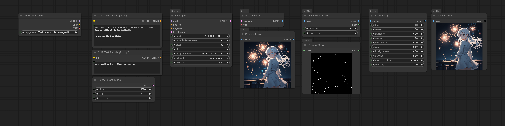

# ComfyUI-Enhance-Pack

[English](README.md) | [한국어](README_ko.md)

Image enhance nodes: colour correction, sharpening, denoising, despeckling and resizing as torch ops on the GPU ComfyUI
computes on.

## Example




## Usage

### Adjust Image

Colour correction, sharpen and denoise filters and an optional resize in one node. Every widget defaults to a no-op,
so the node passes the image through until a slider is moved. RGB is processed and an alpha channel is passed through
untouched.

| Widget | What it does |
|--------|--------------|
| `brightness` | 1.0 = no change, <1.0 darker, >1.0 brighter |
| `contrast` | Scales around mid-gray 0.5 |
| `saturation` | 0.0 = grayscale, >1.0 = more vivid |
| `gamma` | <1.0 brightens mid-tones, >1.0 darkens them |
| `edge_enhance` | Blend factor for a fixed edge-enhance kernel. 0.0 = off |
| `cas` | Contrast Adaptive Sharpening (AMD FidelityFX). Sharpens flat regions more and already-sharp edges less. 0.0 = off |
| `local_contrast` | Large-radius unsharp mask ("clarity") that adds mid-scale depth. 0.0 = off |
| `denoise` | Edge-preserving bilateral filter that removes flat noise and banding while keeping lines. 0.0 = off |
| `upscale_method` | Resampling used when `scale_by` is not 1.0 |
| `scale_by` | Scale factor. 1.0 = no resize |

The order is fixed: brightness → contrast → saturation → gamma → denoise → edge enhance → CAS → local contrast →
resize. Denoise runs before the sharpeners so they do not amplify the noise it removed.

### Despeckle Image

Removes stray bright dots from a generated image and leaves hair strands, highlights and textures alone. A pixel is a
speck when it is brighter than its surroundings, belongs to a blob that fits in a window twice `speck_size`, and the
patch around it holds only a few other such blobs; lines, lit edges, carvings, textured areas and the sheen on a fold
are kept. On a near-black background the threshold drops on its own, so faint salt goes too. Dark lines next to a
speck (an outline, a mouth) are never overwritten. The specks and their dark halo are filled with a weighted average
of the pixels around them, so a gradient under the speck continues through it.

| Widget | What it does |
|--------|--------------|
| `threshold` | How much brighter than its surroundings a pixel must be to count. Default 0.08 |
| `speck_size` | Largest speck to remove, in pixels. Anything this wide or wider (an eye highlight) is kept. Default 5 |
| `mask` (output) | The pixels that were replaced, feathered at the edge |

## Installation

Search for **ComfyUI-Enhance-Pack** in ComfyUI Manager, or:

```bash
cd ComfyUI/custom_nodes
git clone https://github.com/alchemine/comfyui-enhance-pack
```

## Nodes

`EnhancePack/Image`

| Node | Description |
|------|-------------|
| **Adjust Image** | Colour correction, sharpen, denoise and resize |
| **Despeckle Image** | Remove isolated bright dots |

The node id `AdjustImage` is the one comfyui-alchemine-pack used before v8.0.0, so workflows made with that pack load
as they are.

## License

GPL-3.0. See [LICENSE](LICENSE).
